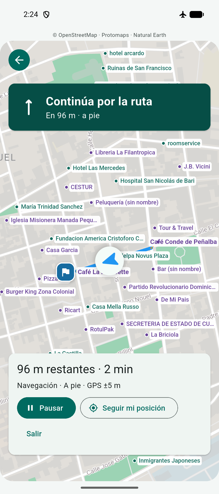
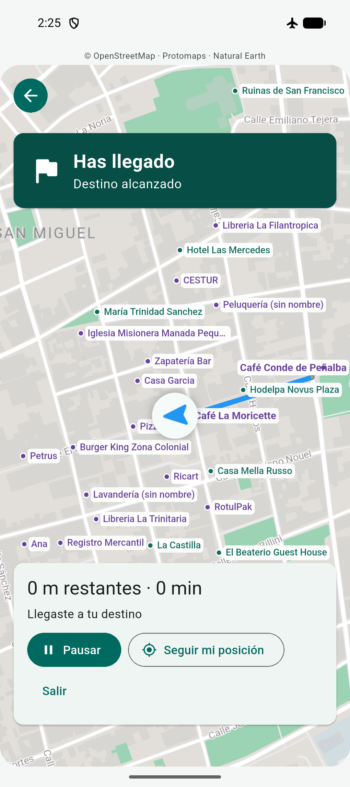

# Calidad de navegación — 1.6.0-demo+12

25/11/2026. Corrección de seguimiento lento, saltos e indicaciones imprecisas
reportados tanto con conexión como sin ella. No cambia la cartografía ni añade
dependencias o servicios remotos.

## Cambios

- La antigüedad GPS parte del reloj monotónico Android, evitando que una hora
  UTC incorrecta del receptor invalide una posición recién obtenida. También
  se conservan las precisiones de velocidad y rumbo que antes se perdían.
- Se rechazan duplicados y saltos incompatibles con el transporte. Una lectura
  descartada no bloquea la siguiente válida. Después de una interrupción se
  amplía la ventana de continuidad según el tiempo transcurrido.
- Una posición con incertidumbre de 36–200 m se muestra en naranja como
  aproximada; no avanza distancia, no confirma llegada y la cámara no sigue sus
  oscilaciones. Con mayor incertidumbre se mantiene la última conocida.
- El rumbo quieto se conserva; sin rumbo GPS fiable se calcula al acumular
  desplazamiento suficiente. Desvíos leves requieren confirmación y tienen
  umbrales distintos de entrada/salida para evitar parpadeos.
- Se mantiene el giro hasta haber pasado 5 m por el cruce. Llegar exige estar
  al final del recorrido, además de cerca del destino; no basta con estar junto
  al destino al principio de un circuito. La llegada confirmada se conserva.
- Se precalculan giros y rumbos. La búsqueda del segmento usa una ventana por
  distancia acumulada, evitando recorrer miles de segmentos por cada fix.
  Lecturas sin cambios visibles no reconstruyen la interfaz. La cámara agrupa
  actualizaciones por frame y reduce la transición de 450 a 180 ms; la flecha
  acompaña la cámara durante la animación. Tras confirmar el usuario que el
  problema principal era el mapa retrasado, se redujo el umbral de seguimiento
  de 2 a 0,5 m para acompañar pasos a pie sin esperar varias lecturas GPS.

## Validación local

`flutter analyze`: sin incidencias. `flutter test --reporter expanded`: **80
pruebas aprobadas**. Se añadieron casos de señal débil/recuperación, duplicados,
salto imposible seguido de lectura válida, circuito, interrupción prolongada,
cruce, desvío, ruido tras llegada y recentrado explícito. Una prueba de cámara
verifica desplazamiento de aproximadamente 1,1 m en 200 ms, conservación del
desplazamiento manual y recentrado al pedirlo.

Prueba determinista de coste: la proyección acotada visita 721 de 20.000
segmentos; encontrar el siguiente giro entre 19.998 usa 14 pasos. Son contadores
de trabajo, no una medición de FPS ni una mejora porcentual en teléfono.

## Reproducir la prueba Android

Resultado nativo: **PASS en ambos escenarios**, Pixel_10a / Android 17 API 37.
Recorrido Conde de Peñalba → La Moricette, 27 muestras progresivas. La distancia
bajó 209,70 → 181,28 → 0 m sin red y 209,70 → 172,85 → 0 m con red. Los valores
intermedios dependen del momento en que la prueba observa el progreso; no son
recorridos distintos. GPS simulado informó ±5 m. Modo sin red: avión activado,
Wi-Fi/datos apagados. Modo con red: avión apagado, Wi-Fi/datos encendidos y
Android confirmó conectividad `VALIDATED`.

Con frames continuos: 2.363 frames sin red, p90 build 1,478 ms / raster 16,899 ms;
2.236 con red, p90 build 3,210 ms / raster 17,612 ms. Medición del fixture en
emulador, sin comparación equivalente de la versión anterior: no acredita una
tasa sostenida de 60 FPS ni rendimiento idéntico en teléfonos.
Estas dos mediciones preceden al último ajuste del umbral de cámara a 0,5 m;
usan pasos de hasta 9 m. El umbral final se verifica con la prueba específica
de pasos de un metro y con el APK normal.

Se descartó una ejecución bloqueada por el diálogo Android de permisos: la
trayectoria había terminado antes de concederse. El helper se corrigió para
aceptarlo antes de inyectar y se repitieron ambos escenarios completos. También
se descartó la medición inicial de solo dos frames al detectar que el fixture
solo renderizaba con pump; la ejecución válida usa `fullyLive`.

Desde `ruta_rd`, en el emulador con ubicación activada, sembrar la posición
`adb -s emulator-5554 emu geo fix -69.8844188 18.4737075` y ejecutar:

```powershell
flutter drive --profile --driver=test_driver/integration_test.dart --target=integration_test/offline_gnss_test.dart -d emulator-5554 *> build/gnss-native.log
```

En otra terminal ejecutar `./tools/inject_navigation_trajectory.ps1`. El helper
acepta el permiso en el emulador y recorre los puntos publicados por el fixture,
con pasos de hasta 9 m separados por al menos un segundo. Se guarda la
trayectoria en `build/gnss-trajectory.json`. La prueba usa frames continuos para
ejercitar el mapa, captura excepciones y exige avance y llegada. Después hay que
reinstalar la aplicación normal con `tools/run_android.ps1`.

## APK final en el emulador

Aplicación normal universal `1.6.0-demo+12` reinstalada mediante
`tools/build_phone.ps1` / `tools/run_android.ps1 -SkipBuild`. **PASS sin red y con
red**: búsqueda A/B, ruta automática, inicio GPS, cámara/flecha acompañando el
recorrido, distancia 209 → 96 → 0 m y llegada. En ambos escenarios se verificó
reanudación al volver de Inicio y conservación de pausa manual al hacer lo
mismo. Android confirmó red validada durante el escenario conectado. Se
restauraron avión/Wi-Fi/datos a sus valores originales al terminar y quedó
abierta la aplicación normal con su ruta. No hay entradas AndroidRuntime de
cierre detectadas en esta comprobación.





APK de **208.547.974 bytes**, código compilado
`7ab70951c22c8d22779823c33e8145ee20f32245`. SHA256:
`5b2220b69ce88f1eca30e2ec5f03da93126f07415791b27a290d476484e23f91`.
La huella del APK instalado en Android coincide con la del archivo entregado.
Firma, ARM32/ARM64/x64, assets y alineación ZIP/ELF de 16 KB: aprobados.

## Alcance físico

Las pruebas Android usan coordenadas GPS simuladas únicamente en el emulador
Pixel_10a. No acreditan precisión satelital física, recepción dentro de casa ni
rendimiento en el Infinix o REVVL del usuario. El mapa, el cálculo y el
seguimiento no requieren internet; la recepción GPS depende del dispositivo y
del entorno. Los tiempos siguen siendo orientativos, sin tráfico en vivo.
