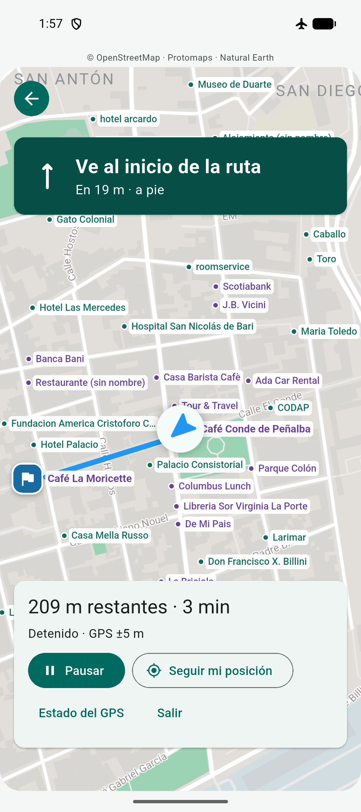
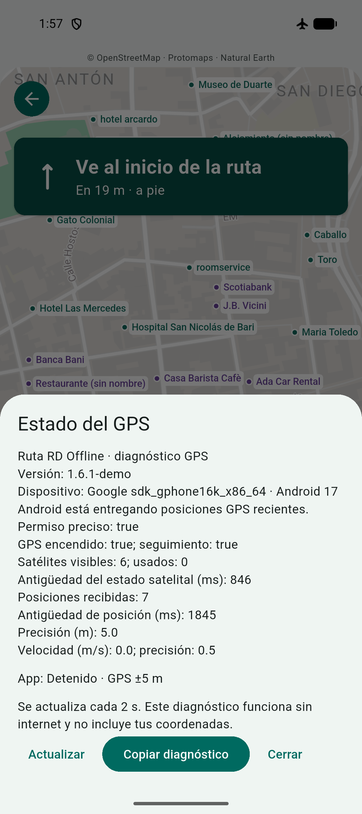

# GPS detenido y diagnóstico — 1.6.1-demo+13

26/11/2026. El usuario informa que la flecha no avanza, es imprecisa y cambia
la distancia sin internet. Las pruebas simuladas de 1.6.0 no demuestran que ese
fallo esté resuelto en su teléfono. No se atribuye a hardware sin medirlo.
El usuario confirmó que ocurre tanto quieto como en movimiento.

## Correcciones y observabilidad

- Antes se perdían velocidad y precisión de velocidad al convertir las lecturas
  nativas para navegación. El controlador podía tratar ruido posicional en
  reposo como movimiento. Ahora se conservan y se mantiene posición/progreso,
  rumbo y ETA cuando el receptor informa reposo fiable dentro del radio de ruido.
  Una velocidad ausente o con incertidumbre desconocida no equivale a reposo.
- La consulta precisa de origen todavía utilizaba Geolocator/LocationManager,
  mientras navegación usaba GPS_PROVIDER. Se verificó en geolocator_android
  5.2.1, LocationManagerClient.getBestLocationProvider, que Android 12+ puede
  elegir `fused`. La consulta precisa pasa al mismo canal satelital, con espera
  de hasta 60 s en vez de 15 s. Mantiene proveedor compatible para permiso
  aproximado. Cancelar/editar/salir libera la consulta, incluso sin primer fix.
- Android registra GnssStatus.Callback durante el seguimiento. **Estado del
  GPS** muestra y copia datos reales del proveedor: versión/dispositivo, permiso,
  satélites informados/usados, antigüedad y precisión del fix, velocidad y estado
  del controlador. No incluye coordenadas ni envía información a servidores.
  No se bloquea navegación por ausencia de contadores satelitales.

El callback y sus campos corresponden a la documentación de
[LocationManager](https://developer.android.com/reference/android/location/LocationManager)
y [GnssStatus](https://developer.android.com/reference/android/location/GnssStatus).
GPS_PROVIDER permite distinguir la solicitud satelital de la selección del
proveedor combinado; no garantiza recepción en interiores ni corrige el sensor.

## Pruebas locales y Android

Análisis sin incidencias y **89 pruebas locales aprobadas**. Se cubren ruido
detenido sin cambio de posición/distancia/rumbo/ETA, salida de reposo, movimiento
lento a 0,4 m/s, ausencia de precisión de velocidad, consulta precisa frente a
aproximada, cancelación durante permisos, cancelación/timeout sin fix y liberación
del receptor. El panel carga datos Android y detiene su actualización al cerrarse.

El fixture AOT nativo pasó en Pixel_10a / Android 17 API 37, avión encendido,
Wi-Fi/datos apagados: consulta satelital del origen, seguimiento 209,70 → 172,85
→ 0 m y consulta de diagnóstico. Android informó 42 lecturas, fix de 732 ms,
precisión 5 m y velocidad 3,087 m/s al final. Son valores **simulados**, no una
medición del teléfono. La inyección declara velocidad de movimiento (6 nudos)
para no presentar desplazamientos de coordenadas con velocidad cero como una
trayectoria coherente. No se usan satélites detectados como condición para navegar.

## APK normal en el emulador

Aplicación universal normal instalada con `tools/build_phone.ps1` y comprobada
en Pixel_10a sin internet y con red validada por Android. **PASS en ambos casos**:
con velocidad cero y desplazamiento simulado de unos 6 m, la distancia permanece
en 209 m; con velocidad de movimiento pasa 209 → 96 → 0 m y confirma llegada.
Se abrió Estado del GPS, se leyeron datos nativos de esta versión, se pulsó Copiar
diagnóstico y se cerró el panel sin detener el seguimiento. También pasaron
reanudación al volver de Inicio y conservación de la pausa manual. Estos datos
se inyectaron exclusivamente en el emulador.

APK de 208.777.350 bytes, código compilado
`004235281a5e17efd37af1965f8df95e90f68bf7`. SHA256:
`79cc3df49327e6be79d7fec3ed53ff5ca14f01a2ac2c945d2c7d9a2874ef2cd4`.
Firma, ARM32/ARM64/x64, assets y alineación ZIP/ELF de 16 KB aprobados; huella
instalada igual al archivo entregado. No se detectaron cierres AndroidRuntime
en la revisión. Se restauraron los ajustes de red originales y quedó abierta
la aplicación normal con su ruta.

## Verificación física pendiente

El usuario ofreció conectar el teléfono donde falla. Hasta obtener lecturas de
ese equipo, no se da por corregido el fallo físico. La prueba necesaria es abrir
esta versión con ubicación precisa, registrar Estado del GPS quieto y en
movimiento, repetir sin Wi-Fi/datos y comparar recepción frente al estado de la
app. No es necesario comprar otro teléfono para diagnosticarlo.
